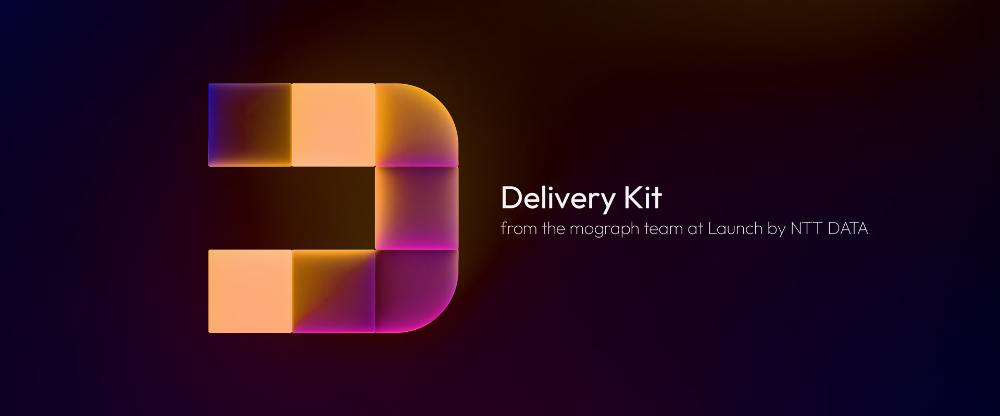
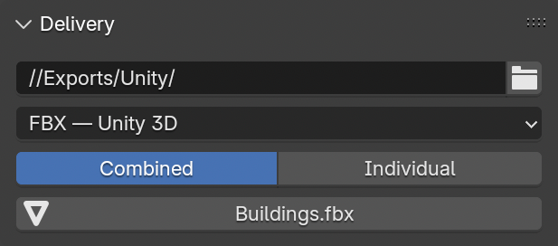

# Launch Delivery Kit — Quick Blender Exports

## Features:

- File I/O for custom data formats:
  
  - CSV — either all points within a mesh or transforms over time
  
  - SVG Curves — translation between Blender curves and SVG vectors
    - Includes conversion between Bézier and NURBS formats within Blender
  
  - SplineMaker JSON — project import/export for VR curve editing of NURBS splines
    - [Experience for Meta Quest 3](https://github.com/jeinselen/Godot-SplineMaker)
  
- One-click export of the current selection (or the active collection) to a chosen folder, with presets for:

  - FBX — Unity 3D and Unreal Engine
  - GLB — ThreeJS (Draco compressed)
  - GLTF — Godot Engine
  - OBJ — VideoCopilot Element 3D
  - USDZ — Apple / Xcode
  - STL — 3D printing (per-object)
  - CSV — vertex points or object transforms over time
  - JSON — SplineMaker curve data
  - SVG — Bézier, NURBS, and poly line curves as 2D vectors
  - Combined or individual files, static or animated output, and a keyboard shortcut (Shift+Alt+Cmd/Ctrl+E)

  

## Installation via Extensions Platform:

- Go to Blender Preferences > Get Extensions > Repositories > **＋** > Add Remote Repository
- Set the URL to `https://jeinselen.github.io/Launch-Blender-Extensions/index.json`
- Enable `Check for Updates on Start`
- Filter the available extensions for "Launch" and install as needed

## Installation via Drag-and-Drop:

- Click and drag one of the file links from the [repository list page](https://jeinselen.github.io/Launch-Blender-Extensions/) into Blender

## Installation via Download:

- Download the extension .zip
- Drag-and-drop the file into Blender

These latter two methods will not connect to the centralised repository here on GitHub and updates will not be automatically available. If you don't need easy updates, don't want GitHub servers to be pinged when you start up Blender, or would just like to try some extensions without adding yet another repository to your Blender settings, this is the option for you.

## Notes:

Software is provided as-is with no warranty or provision of suitability. These are internal tools and are shared because we want to support an open community. Bug reports are welcomed, but we cannot commit to fixing or adding features. Not all features may be actively maintained, as they're updated on an as-needed basis.
